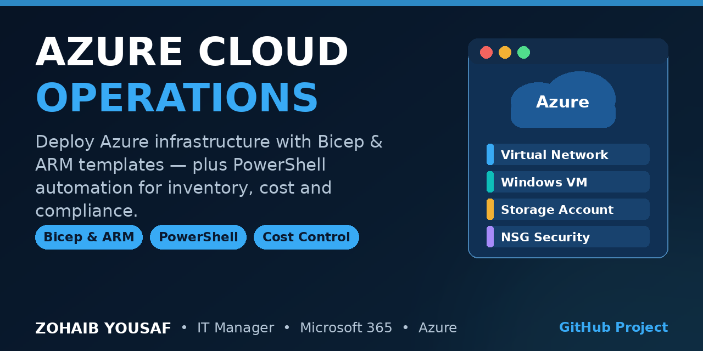

# Azure Cloud Operations



Infrastructure as code and day-to-day operations scripts for a small Azure environment, written and maintained by Zohaib Yousaf, IT Manager. The project contains a parameterised Bicep template (with the equivalent ARM template) for a single-workload Azure footprint, plus four Az PowerShell scripts covering inventory, cost, VM operating hours, and tag governance.

The emphasis is on safe operations: templates take secrets only as secure parameters, the network is closed by default, and three of the four scripts are read-only. The one script that changes state selects its targets by tag and supports `-WhatIf`.

## What the template deploys

The template in `infra/` deploys, into an existing resource group:

- **Virtual network** — one address space (default `10.20.0.0/16`) with a single workload subnet (default `10.20.1.0/24`).
- **Network security group** — attached to the subnet. Inbound traffic is denied by default; the only allow rule opens RDP (3389) to a single admin or VPN address range supplied as a parameter. Web traffic is deliberately not opened on the VM.
- **Windows Server 2022 virtual machine** — Azure Edition image, Premium SSD OS disk, automatic updates enabled, system-assigned managed identity turned on, boot diagnostics sent to the storage account.
- **Storage account** — Standard LRS, StorageV2, HTTPS only, TLS 1.2 minimum, public blob access disabled. Used for boot diagnostics and shared data.

All resources receive the same tag set (Environment, Owner, CostCenter, ManagedBy), which the cost and tag-compliance scripts in this repository rely on.

## Project structure

```
azure-cloud-operations/
  infra/
    main.bicep                     Bicep template (source of truth)
    azuredeploy.json               Equivalent ARM template
    azuredeploy.parameters.json    Example parameters — placeholder values only
  scripts/
    Get-AzureResourceInventory.ps1   Resource inventory export (read-only)
    Get-AzureCostSummary.ps1         Cost by resource group (read-only)
    Set-AzureVMOperatingHours.ps1    Start/stop VMs by tag (supports -WhatIf)
    Test-AzureTagCompliance.ps1      Required-tag audit (read-only)
  LICENSE
  README.md
```

## Prerequisites

- An Azure subscription and a resource group to deploy into.
- Azure CLI 2.50 or later (for the Bicep deployment), or the Az PowerShell modules.
- For the Bicep file: the Azure CLI includes Bicep support; no separate install is needed for a standard deployment.
- For the scripts: PowerShell 7 recommended (Windows PowerShell 5.1 also works), with these modules installed:

```powershell
Install-Module Az.Accounts, Az.Resources, Az.Compute, Az.CostManagement
```

- Permissions: Contributor on the target resource group to deploy; Reader is enough for the inventory and tag scripts; Cost Management Reader for the cost script; Virtual Machine Contributor for the operating-hours script.

## Deployment

### Option 1 — Azure CLI with Bicep

```bash
az group create --name rg-ops-test --location westeurope

az deployment group create \
  --resource-group rg-ops-test \
  --template-file infra/main.bicep \
  --parameters infra/azuredeploy.parameters.json \
  --parameters adminPassword="$(az keyvault secret show --vault-name <vault> --name vm-admin-password --query value -o tsv)"
```

### Option 2 — Azure CLI with the ARM template

```bash
az deployment group create \
  --resource-group rg-ops-test \
  --template-file infra/azuredeploy.json \
  --parameters infra/azuredeploy.parameters.json
```

### Option 3 — PowerShell

```powershell
New-AzResourceGroupDeployment `
  -ResourceGroupName 'rg-ops-test' `
  -TemplateFile '.\infra\main.bicep' `
  -TemplateParameterFile '.\infra\azuredeploy.parameters.json'
```

Before deploying anywhere real: edit the parameters file — set `adminSourceAddressPrefix` to your own admin or VPN range, choose the environment and region, and replace the password placeholder at deploy time from Key Vault or a prompt (see Security notes). Validate first with `az deployment group validate` or a `-WhatIf` deployment (`az deployment group create --confirm-with-what-if`).

## Scripts

| Script | Purpose | Changes state |
|---|---|---|
| `Get-AzureResourceInventory.ps1` | Lists every resource (name, type, resource group, location, SKU, tags) in the subscription or one resource group; optional CSV export for asset registers and audits. | No |
| `Get-AzureCostSummary.ps1` | Cost Management query that returns cost grouped by resource group for a time frame (month to date by default, custom range supported); optional CSV export. | No |
| `Set-AzureVMOperatingHours.ps1` | Starts or deallocates VMs selected by tag (default tag `OperatingHours`) for out-of-hours cost saving. Deallocation is used on stop so compute billing actually stops. | Yes — tag-selected VMs only, supports `-WhatIf` and `-Confirm` |
| `Test-AzureTagCompliance.ps1` | Checks resource groups and resources for required tags (Environment, Owner, CostCenter by default) and reports which are missing, per resource; optional CSV export. | No |

Examples:

```powershell
# Inventory the whole subscription to CSV
.\scripts\Get-AzureResourceInventory.ps1 -OutputPath .\inventory.csv

# Last month's cost by resource group
.\scripts\Get-AzureCostSummary.ps1 -TimeFrame TheLastMonth

# Preview an evening shutdown — changes nothing
.\scripts\Set-AzureVMOperatingHours.ps1 -Action Stop -TagValue 'BusinessHours' -WhatIf

# Tag audit for one resource group
.\scripts\Test-AzureTagCompliance.ps1 -ResourceGroupName 'rg-ops-prod' -OutputPath .\tag-report.csv
```

## Security notes

- **No secrets in this repository.** There are no real passwords, keys, subscription IDs, or tenant details in any file. The parameters file contains placeholders only, and the admin password is a `secure` parameter in both templates.
- **Never commit a real parameters file.** Pass the VM admin password at deploy time from Azure Key Vault (as in the CLI example above) or an interactive prompt, and add any real parameters file to `.gitignore` — the pattern is already included.
- **Prefer managed identity over stored credentials.** The VM is deployed with a system-assigned managed identity; grant it only the RBAC roles and Key Vault access policies it needs, instead of embedding credentials in scripts or on the machine.
- **Network exposure is minimal by design.** The NSG denies all inbound traffic except RDP from the admin range you supply. For production, consider removing the RDP rule entirely and using Azure Bastion or just-in-time VM access instead.
- **Least privilege for automation.** Run the operating-hours script from a managed identity or service principal scoped to the resource groups it manages, not from a personal account with subscription-wide rights.
- **Review before you deploy.** Run a What-If deployment and read the change list; templates in this repository are a starting point for a small environment, not a substitute for your organisation's landing-zone and backup policies.

## Author

**Zohaib Yousaf** — IT Manager, Islamabad, Pakistan
6+ years in IT operations: SCCM / Intune, Microsoft 365, Azure, LAN/WAN. Microsoft MS-900 in progress.

- Website: [zohaibyousaf.com](https://zohaibyousaf.com)
- LinkedIn: [linkedin.com/in/zohaibyousaf](https://linkedin.com/in/zohaibyousaf)
- Email: info@zohaibyousaf.com

## License

MIT — see [LICENSE](LICENSE).
